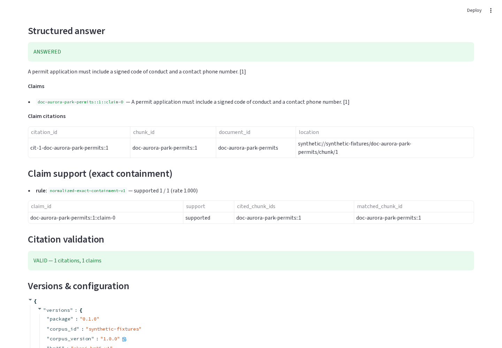
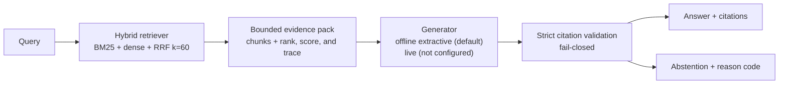

<p align="center"></p>

<p align="center"><a href="README.md">Español</a> · <b>English</b></p>

Retrieval-augmented generation in which every answer is tied to its evidence: hybrid retrieval (BM25 + embeddings), strictly validated citations, mandatory abstention, and reproducible evaluation. It runs offline by default, with no API keys.

[](https://github.com/Eduardo12Pacheco/sistema-rag-con-evidencia/actions/workflows/ci.yml) [](LICENSE) [](pyproject.toml)

> **Status: implementation complete for the declared scope.** Live LLM generation is **not evaluated**: no provider, model, or credentials are configured. The default generation is extractive and deterministic; it is not an LLM (`is_llm_generated = False`).

## Why it exists

A fluent answer is not a reliable answer. Without mandatory citations and abstention, a RAG system can sound confident while making things up. This project makes evidence the product:

- **Citations are validated, not trusted.** A citation must exist, have been exposed to the generator, match the passage text exactly, and be referenced by a claim. If any one condition fails, the answer is rejected (fail-closed).
- **Abstention is a valid result.** When evidence is missing, insufficient, or conflicting, the system returns a stable reason code instead of a weak answer. An unconfigured live provider answers `provider_unavailable` and never falls back to offline mode.
- **Retrieval and faithfulness are measured separately.** High recall does not prove that an answer is faithful, and the reports say so.
- **The core has no runtime dependencies.** The demo (`streamlit`) and the semantic embeddings (`sentence-transformers`) are optional extras.

## Demo (offline)



Real demo output over the synthetic corpus:

| Query | State | Result |
| --- | --- | --- |
| `What must a permit application include?` | `answered` | Cited answer: *"A permit application must include a signed code of conduct and a contact phone number. [1]"*. Citations **VALID**. |
| `How much is the special event fee per day?` | `conflicting` | `conflicting_evidence`: two contradictory fees exist, and the system shows the conflict. |
| `What is the fine for littering in Millbrook?` | `abstained` | `unsupported_query`: the question is outside the corpus. |

Full script and additional captures are in [`docs/demo-script.md`](docs/demo-script.md) and [`docs/assets/publication/`](docs/assets/publication/).

## Architecture

A query goes through the hybrid retriever, is packed as bounded evidence, the generator produces cited claims, and the validator decides whether the answer is published or the system abstains.



```text
src/evidence_grounded_rag/
├── corpus/        # license-gated loading, source manifest audit, privacy, checksums
├── text/          # shared deterministic tokenizer (v1, no stemming)
├── retrieval/     # BM25, dense, RRF fusion, hybrid engine, traces
├── embeddings/    # protocol, non-semantic hash embedding, opt-in local semantic provider
├── generation/    # claim/citation models, extractive provider, live adapter, frozen prompt
├── validation/    # strict citation validation (fail-closed)
├── abstention/    # mandatory abstention reason codes
├── evaluation/    # committed metrics, versioned query sets, materializers
└── pipeline.py    # EvidenceRagPipeline: retrieve → generate → validate
```

## Retrieval modes

| Mode | Served by | Semantic? |
| --- | --- | --- |
| **Sparse BM25** | Okapi BM25 (`k1 = 1.5`, `b = 0.75`, no stemming) | No: lexical |
| **Hash embedding diagnostic** | `deterministic-hashed-bow-v1`, 256 dimensions, offline, no weights | **No**: it only measures token overlap |
| **Local semantic embeddings** | BAAI/bge-small-en-v1.5 (384 dimensions, opt-in, local only, pinned revision) | Yes |
| **Semantic hybrid** | BM25 + local semantic embeddings, RRF fusion `k = 60` | Yes (semantic component) |

Semantic modes load the verified local model with `local_files_only=True` and **never** fall back to hash embeddings. If the model is unavailable, semantic retrieval is disabled with an actionable message. Contract: [`docs/embedding-model-contract.md`](docs/embedding-model-contract.md).

## Results

Every number comes from committed reports in `data/evaluations/` and `data/manifests/`. Each one can be reproduced with a command; see [Reproduce the evaluations](#reproduce-the-evaluations).

### Synthetic fixture (default)

11 queries over fictional "Aurora City" fixtures. These describe fictional content, not a real institution.

| recall@1 | recall@5 | recall@10 | MRR | nDCG@5 | answerable coverage | abstention rate | unsupported claims |
| --- | --- | --- | --- | --- | --- | --- | --- |
| 0.8333 | 1.0000 | 1.0000 | 1.0000 | 1.0000 | 1.0000 | 0.3636 | 0.0000 |

### Real local corpus: Python 3.12.13 documentation

3 files and 70 chunks, approved for local development only. There are 18 queries: 12 answerable and 6 unanswerable.

**Retrieval** (12 answerable queries; no generation in this table):

| Mode | recall@1 | recall@5 | recall@10 | MRR | nDCG@5 |
| --- | --- | --- | --- | --- | --- |
| Sparse BM25 | 0.5417 | 0.7917 | 0.8750 | 0.7202 | 0.7207 |
| Hash embedding diagnostic | 0.3333 | 0.5417 | 0.8333 | 0.4545 | 0.4289 |
| Local semantic embeddings | 0.6667 | 0.8750 | 0.9167 | 0.8333 | 0.8035 |
| Semantic hybrid | 0.6250 | 0.9167 | 0.9583 | 0.7778 | 0.7968 |

**Offline generation** (extractive, diagnostic only):

| answer coverage | abstention rate | abstention precision | abstention recall | citation precision | citation completeness | claim support |
| --- | --- | --- | --- | --- | --- | --- |
| 0.9167 | 0.3889 | 0.5714 | 0.6667 | 1.0000 | 1.0000 | 1.0000 (19/19) |

Failures: 3 abstentions on answerable queries (`insufficient_evidence`) and 2 wrong answers.

**Faithfulness by mode** (diagnostic; the "dense" mode uses the hash embedding, which is not semantic):

| Mode | Answer coverage | Abstention precision | Abstention recall | Unsupported claims | Wrong answers |
| --- | --- | --- | --- | --- | --- |
| Sparse BM25 | 0.9167 | 0.7500 | 0.5000 | 0.0000 | 3 |
| Dense (hash, not semantic) | 0.7500 | 0.6250 | 0.8333 | 0.0000 | 1 |
| Hybrid (dense = hash) | 0.7500 | 0.5714 | 0.6667 | 0.0000 | 2 |

With denominators this small, a single query moves the percentages by up to 8.3 points. Claim support is normalized containment, not semantic entailment.

## Quick start

Requirements: [uv](https://docs.astral.sh/uv/) and Python 3.11 or later (uv can install the interpreter if you do not have one).

```bash
uv sync --dev --extra demo                                  # dependencies, tests, and demo
uv run pytest                                               # offline test suite
uv run ruff check .                                         # lint
uv run --extra demo streamlit run scripts/demo_retrieval.py # demo in the browser
```

`uv run pytest` skips the tests that need the local real corpus or the `embeddings` extra when those artifacts are absent.

<details>
<summary>Local real corpus (optional, not committed)</summary>

```bash
uv run python scripts/acquire_corpus.py --manifest data/manifests/corpus-source-v1.0.0.json
uv run python scripts/verify_corpus.py --manifest data/manifests/corpus-source-v1.0.0.json
```

Acquisition downloads the files from pinned URLs and verifies their SHA-256 checksums. The files are stored in `data/raw/`, which is excluded from version control.

</details>

<details>
<summary>Local semantic embeddings (optional, installs torch and transformers)</summary>

```bash
uv sync --dev --extra demo --extra embeddings
uv run python scripts/acquire_embedding_model.py --manifest data/manifests/embedding-model-v1.0.0.json
uv run python scripts/verify_embedding_model.py --manifest data/manifests/embedding-model-v1.0.0.json
```

</details>

## Reproduce the evaluations

Run these commands from the repository root. Commands that use the real corpus require the local corpus (see [Quick start](#quick-start)).

```bash
uv run python -m evidence_grounded_rag.evaluation.materialize            # synthetic fixture

uv run python -m evidence_grounded_rag.evaluation.real_materialize \
    --manifest data/manifests/corpus-source-v1.0.0.json \
    --queries data/queries/python-docs-real-v1.0.0.json \
    --raw-dir data/raw/python-docs-3.12.13 \
    --output data/evaluations/python-docs-real-evaluation-v1.0.0.json

uv run python -m evidence_grounded_rag.evaluation.generation_materialize \
    --manifest data/manifests/corpus-source-v1.0.0.json \
    --queries data/queries/python-docs-real-v1.0.0.json \
    --raw-dir data/raw/python-docs-3.12.13 \
    --fixture data/fixtures/answer-evaluation-v1.0.0.json \
    --output data/evaluations/python-docs-real-generation-evaluation-v1.0.0.json

uv run python -m evidence_grounded_rag.evaluation.semantic_materialize \
    --manifest data/manifests/corpus-source-v1.0.0.json \
    --queries data/queries/python-docs-real-v1.0.0.json \
    --raw-dir data/raw/python-docs-3.12.13 \
    --model-manifest data/manifests/embedding-model-v1.0.0.json \
    --cache-dir data/raw/models/bge-small-en-v1.5 \
    --output data/evaluations/python-docs-real-semantic-evaluation-v1.0.0.json
```

## Limitations

- **Live LLM generation was not evaluated.** No provider, model, or credentials are configured. Offline generation is deterministic extraction, not an LLM.
- **Claim support is normalized containment, not entailment.** A claim is supported if its normalized text appears literally in the cited passage.
- **The real corpus is small and diagnostic.** It is 3 files and 70 chunks from the Python 3.12.13 documentation, approved for local development only. It is not a validation of the Python documentation in general and not a claim of production readiness.
- **Denominators are small.** There are at most 12 answerable and 6 unanswerable queries per report.
- **Gob.ec is blocked and unused.** Its CC-BY-4.0 label conflicts with the linked `by/3.0/ec` terms, and the discrepancy is unresolved ([contract](docs/corpus-license-contract.md)).
- No claim is made of production readiness, absence of hallucinations, or benchmark parity.

## Documentation

- [Product](docs/PRODUCT.md) · [Design](docs/DESIGN.md) · [Demo script](docs/demo-script.md)
- [Generation contract](docs/generation-contract.md) · [Embedding model contract](docs/embedding-model-contract.md) · [Corpus and license contract](docs/corpus-license-contract.md)
- [Retrieval and evaluation protocol](docs/retrieval-evaluation-protocol.md)

The linked documents are written in Spanish.

## Data and license

- The original code and the synthetic fixtures are released under the MIT license ([`LICENSE`](LICENSE)). The MIT text does not cover third-party data, manifests, source citations, or other external content, which keep their own terms.
- The approved real corpus (Python 3.12.13 documentation, PSF License v2) is used for local development only. Its raw text is never committed, packaged, or published.
- The BAAI/bge-small-en-v1.5 weights (MIT) are downloaded locally at a pinned revision and are not committed. The manifests and checksums are.
- No unlicensed corpus is ever indexed. Gob.ec is not used.

## Author

Eduardo Pacheco · [github.com/Eduardo12Pacheco](https://github.com/Eduardo12Pacheco)
