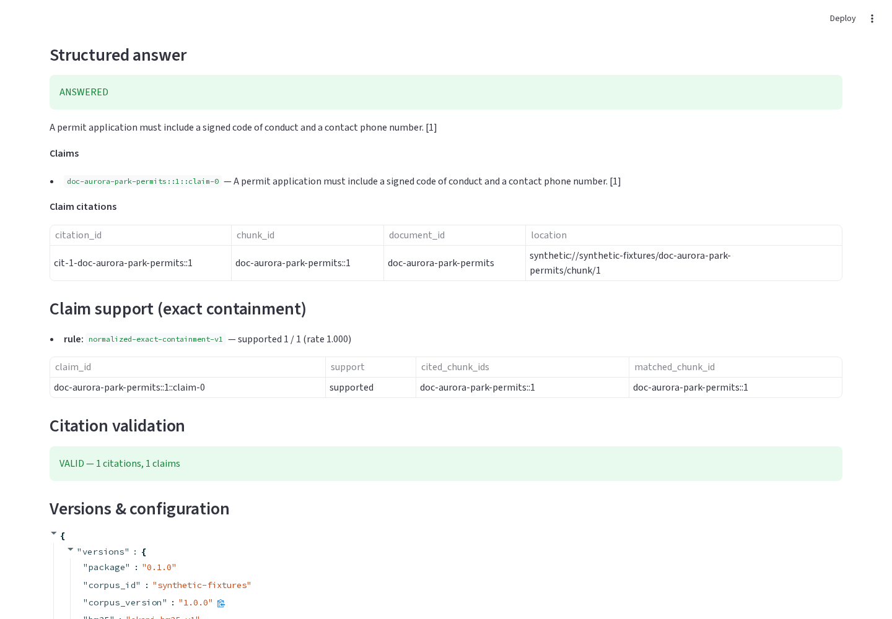
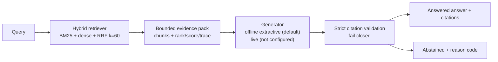

# Sistema RAG basado en evidencia

> **TL;DR (English)** — Evidence-grounded RAG with hybrid retrieval, strict citations, mandatory abstention and reproducible evaluation; declared scope complete, live LLM generation not evaluated.
> Quickstart: `uv sync --dev --extra demo` · `uv run pytest` · `uv run --extra demo streamlit run scripts/demo_retrieval.py` (offline, no API keys).
>
> | real local Python docs — recall@5 (12 answerable queries) | BM25 sparse | Local semantic embeddings | Semantic hybrid |
> | --- | --- | --- | --- |
> | Retrieval quality | 0.7917 | 0.8750 | 0.9167 |

Un sistema RAG greenfield donde **las respuestas están ligadas a la evidencia**:
recuperación híbrida (sparse + dense), generación con citas, abstención
obligatoria y evaluación reproducible de recuperación y soporte de afirmaciones.
Las respuestas solo son tan buenas como los pasajes que las respaldan, y el
sistema se abstiene con un código de razón estable cuando falta la evidencia.

**Estado — implementación completa para el alcance declarado.** La evaluación
con fixture sintético es la opción por defecto y está completamente comprometida
y es reproducible. Un corpus local real (documentación de Python 3.12.13,
**3 archivos / 70 fragmentos**) está aprobado solo para desarrollo local, y un
modelo local de embeddings semánticos (BAAI/bge-small-en-v1.5) está aprobado y es
opt-in. **La generación en vivo con LLM NO fue evaluada** — no hay ningún
proveedor/modelo/credencial configurado. El corpus Gob.ec está **bloqueado y sin
usar** (discrepancia de licencia sin resolver).



## Capacidades

| Capacidad | Qué hace |
| --- | --- |
| Corpus con gate de licencia | Ningún corpus real se sirve hasta que su contract de licencia se satisface; Gob.ec está bloqueado y sin usar (`docs/corpus-license-contract.md`) |
| Procedencia estable | Manifests de fuente versionados con revisiones fijadas y checksums SHA-256; el texto crudo y los pesos nunca se comprometen, los manifests sí |
| Recuperación sparse | Okapi BM25 (`k1 = 1.5`, `b = 0.75`, sin stemming) — léxica, determinista |
| Recuperación semántica | Embeddings semánticos locales (BAAI/bge-small-en-v1.5, opt-in) más un hash no semántico determinista como diagnóstico; nunca un fallback silencioso |
| Recuperación híbrida | BM25 + embeddings dense fusionados con fusión de rango recíproco (RRF, `k = 60`) |
| Generación basada en evidencia | Cada afirmación cita el fragmento exacto que la respalda; el generador solo ve un paquete de evidencia acotado |
| Validación estricta de citas | Fail-closed: una cita debe existir, estar expuesta, coincidir con el extracto y ser referenciada por una afirmación — o la respuesta se rechaza |
| Abstención obligatoria | Se abstiene con un código de razón estable cuando la evidencia es insuficiente, sin respaldo o conflictiva |
| Verificación de soporte de afirmaciones | `normalized-exact-containment-v1` determinista: una afirmación está respaldada si su texto normalizado es una subcadena del fragmento citado (**contención, no entailment semántico**) |
| Generación offline | Extracción determinista, no un LLM (`is_llm_generated = False`) |
| Límite de proveedor en vivo | Adaptador neutral de proveedor, deliberadamente no configurado; requiere un transporte inyectado, falla cerrado con `provider_unavailable`, nunca cae al modo offline |
| Evaluación reproducible | Fórmulas de métricas comprometidas + conjuntos de consultas versionados comprometidos; cada número es reproducible desde un comando |
| Testing | Suite pytest de comportamiento real, completamente offline; la abstención se testea como comportamiento requerido |

La generación offline es **extracción determinista, no un LLM**
(`is_llm_generated = False`). La generación en vivo es neutral de proveedor y
deliberadamente no configurada: requiere un transporte inyectado, falla cerrado
con `provider_unavailable` y nunca cae al modo offline. Ver
`docs/generation-contract.md`.

## Por qué

Las respuestas fluidas no son respuestas confiables. Sin cita obligatoria y
abstención, un sistema RAG puede sonar seguro mientras fabrica. Este proyecto
hace de la evidencia el producto: la calidad de la recuperación se reporta por
separado de la fidelidad, y **la calidad de la recuperación no prueba la
fidelidad de la respuesta.**

## Arquitectura



```text
src/evidence_grounded_rag/
├── corpus/        # carga con gate de licencia, auditoría de source manifest, privacidad, checksums
├── text/          # tokenizador determinista compartido (v1, sin stemming)
├── retrieval/     # BM25, dense, fusión RRF, motor híbrido, traces
├── embeddings/    # protocolo de embeddings + embedding determinista no semántico + proveedor semántico local opt-in
├── generation/    # modelos de afirmación/cita, proveedor extractivo, adaptador en vivo, prompt congelado
├── validation/    # validación estricta de citas (fail-closed)
├── abstention/    # códigos de razón de abstención obligatoria
├── evaluation/    # métricas comprometidas, conjuntos de consultas versionados, materializers
└── pipeline.py    # EvidenceRagPipeline: retrieve → generate → validate
```

## Los cuatro modos de recuperación

| Modo | Qué lo sirve | ¿Semántico? |
| --- | --- | --- |
| **Línea base sparse BM25** | Okapi BM25 (`k1 = 1.5`, `b = 0.75`, sin stemming) | No — léxico |
| **Diagnóstico de embedding hash** | `deterministic-hashed-bow-v1`, 256-dim, offline, sin pesos | **No — explícitamente NO semántico**; los puntajes codifican solo solapamiento de tokens |
| **Embeddings semánticos locales** | BAAI/bge-small-en-v1.5 (384-dim, opt-in, solo local, revisión fijada) | Sí |
| **Híbrido semántico** | BM25 + embeddings semánticos locales, RRF `k = 60` | Sí (componente semántico) |

Los modos semánticos cargan el modelo local verificado con
`local_files_only=True` y **nunca caen** a embeddings hash; si el modelo no está
disponible, la recuperación semántica se deshabilita con un mensaje accionable.
Contract: `docs/embedding-model-contract.md`.

## Evaluación (todos los números de reportes comprometidos)

### Fixture sintético (por defecto) — `data/manifests/evaluation-synthetic-v1.0.0.json`

Determinista, 11 consultas comprometidas sobre los fixtures ficticios de "Aurora
City". Estos números describen **contenido ficticio**, no ninguna institución
real.

| recall@1 | recall@5 | recall@10 | MRR | nDCG@5 | answerable coverage | abstention rate | unsupported claims |
| --- | --- | --- | --- | --- | --- | --- | --- |
| 0.8333 | 1.0000 | 1.0000 | 1.0000 | 1.0000 | 1.0000 | 0.3636 | 0.0000 |

### Generación local real (híbrida / extractiva offline) — `python-docs-real-generation-evaluation-v1.0.0.json`

18 consultas (12 respondibles, 6 no respondibles). **Solo diagnóstico.** La
generación en vivo NO se mide explícitamente: no existen proveedor/modelo/
credenciales, por lo que ningún LLM produjo ninguno de estos números.

| answer coverage | abstention rate | abstention precision | abstention recall | citation precision | citation completeness | claim support |
| --- | --- | --- | --- | --- | --- | --- |
| 0.9167 | 0.3889 | 0.5714 | 0.6667 | 1.0000 | 1.0000 | 1.0000 (19/19) |

Fallos: 3 abstenciones respondibles (`insufficient_evidence`) y 2 respuestas
incorrectas.

### Recuperación semántica local real (solo recuperación) — `python-docs-real-semantic-evaluation-v1.0.0.json`

Grupo respondible (12 consultas) por modo. **Sin generación, sin LLM, sin
métricas de fidelidad aquí.** La calidad de la recuperación no implica la
fidelidad de la respuesta.

| Modo | recall@1 | recall@5 | recall@10 | MRR | nDCG@5 |
| --- | --- | --- | --- | --- | --- |
| Línea base sparse BM25 | 0.5417 | 0.7917 | 0.8750 | 0.7202 | 0.7207 |
| Diagnóstico de embedding hash | 0.3333 | 0.5417 | 0.8333 | 0.4545 | 0.4289 |
| Embeddings semánticos locales | 0.6667 | 0.8750 | 0.9167 | 0.8333 | 0.8035 |
| Híbrido semántico | 0.6250 | 0.9167 | 0.9583 | 0.7778 | 0.7968 |

### Diagnóstico hash local real (soporte de afirmaciones por modo) — `python-docs-real-evaluation-v1.0.0.json`

El reporte de diagnóstico anterior (modo dense de hash determinista), mantenido
separado. **El soporte de afirmaciones aquí es contención, no una evaluación
completa de fidelidad.**

| Modo | answerable coverage | abstention precision | abstention recall | unsupported claims | wrong answers |
| --- | --- | --- | --- | --- | --- |
| BM25 sparse | 0.9167 | 0.7500 | 0.5000 | 0.0000 | 3 |
| Dense (hash, no semántico) | 0.7500 | 0.6250 | 0.8333 | 0.0000 | 1 |
| Híbrido | 0.7500 | 0.5714 | 0.6667 | 0.0000 | 2 |

Todos los reportes viven en `data/evaluations/`. Protocolo:
`docs/retrieval-evaluation-protocol.md`.

## Limitaciones

> - **La generación en vivo con LLM NO fue evaluada.** No hay
>   proveedor/modelo/credenciales configurados. La generación offline es
>   extracción determinista, no un LLM.
> - **El soporte de afirmaciones es contención normalizada, no entailment.** Una
>   afirmación está respaldada si su texto normalizado aparece textualmente en el
>   fragmento citado.
> - **El corpus real es diminuto y de diagnóstico.** Docs de Python 3.12.13,
>   3 archivos / 70 fragmentos, aprobado solo para desarrollo local — no una
>   validación de la documentación de Python en general ni aptitud de producción.
> - **Los documentos reales crudos y los pesos de modelo no se comprometen.**
>   Viven solo bajo el `data/raw/` gitignored; los artefactos comprometidos son
>   manifests y checksums.
> - **Denominadores pequeños.** Hasta 12 consultas respondibles / 6 no
>   respondibles por reporte; una consulta mueve los porcentajes hasta 8,3
>   puntos.
> - **Gob.ec está bloqueado y sin usar.** Su etiqueta CC-BY-4.0 entra en conflicto
>   con los términos `by/3.0/ec` enlazados; la discrepancia no está resuelta
>   (`docs/corpus-license-contract.md`).
> - No se hace ninguna afirmación de aptitud de producción, ausencia de
>   alucinaciones ni paridad de benchmark.

## Ejecute el sistema

```bash
uv sync --dev --extra demo           # núcleo + demo (sin stack de modelos)
uv run pytest                        # tests de comportamiento real, offline
uv run ruff check .                  # lint
uv run --extra demo streamlit run scripts/demo_retrieval.py   # demo offline
```

Embeddings semánticos opcionales (gran footprint de torch/transformers):

```bash
uv sync --dev --extra demo --extra embeddings
uv run python scripts/acquire_embedding_model.py --manifest data/manifests/embedding-model-v1.0.0.json
uv run python scripts/verify_embedding_model.py --manifest data/manifests/embedding-model-v1.0.0.json
```

## Recorrido de 60-90 segundos

1. **Abra la demo.** Un banner SINTÉTICO / OFFLINE y el panel de corpus y licencia
   son visibles, incluido el bloqueador de corpus real (Gob.ec bloqueado).
2. **Haga una pregunta soportada.** La consulta por defecto *"What must a permit
   application include?"* responde con una afirmación citada — *"A permit
   application must include a signed code of conduct and a contact phone
   number. [1]"* — y la validación de citas muestra **VÁLIDA**.
3. **Dispare un conflicto.** Pregunte *"How much is the special event fee per
   day?"*: existen dos tarifas contradictorias, por lo que el sistema muestra
   **CONFLICTING EVIDENCE: conflicting_evidence** y explica la contradicción.
4. **Dispare la abstención.** Pregunte *"What is the fine for littering in
   Millbrook?"*: fuera de corpus, por lo que el sistema se abstiene con
   `unsupported_query`.
5. **Compare modos.** Cambie entre sparse / dense / hybrid (o, en el corpus local
   real, los cuatro modos etiquetados). La respuesta se fundamenta en el modo
   seleccionado mientras todos los candidatos permanecen visibles.
6. **Trace cualquier afirmación.** El paquete de evidencia, el trace y los paneles
   de versiones/configuración trazan cada afirmación a un fragmento, rango,
   puntaje y versión comprometida específicos.

Guion completo: `docs/demo-script.md`.

Capturas de pantalla adicionales (salida real de la aplicación, capturada en modo
offline):
[resumen sintético](docs/assets/publication/01-synthetic-overview.png) ·
[abstención](docs/assets/publication/03-abstention.png) ·
[recuperación semántica local real](docs/assets/publication/04-real-local-semantic.png) ·
[modelo no disponible](docs/assets/publication/05-model-unavailable.png).

## Reproduzca las evaluaciones

```bash
uv run python -m evidence_grounded_rag.evaluation.materialize   # reporte sintético
uv run python -m evidence_grounded_rag.evaluation.real_materialize \
    --manifest data/manifests/corpus-source-v1.0.0.json \
    --queries data/queries/python-docs-real-v1.0.0.json \
    --raw-dir data/raw/python-docs-3.12.13 \
    --output data/evaluations/python-docs-real-evaluation-v1.0.0.json
uv run python -m evidence_grounded_rag.evaluation.generation_materialize \
    --manifest data/manifests/corpus-source-v1.0.0.json \
    --queries data/queries/python-docs-real-v1.0.0.json \
    --raw-dir data/raw/python-docs-3.12.13 \
    --fixture data/fixtures/answer-evaluation-v1.0.0.json \
    --output data/evaluations/python-docs-real-generation-evaluation-v1.0.0.json
uv run python -m evidence_grounded_rag.evaluation.semantic_materialize \
    --manifest data/manifests/corpus-source-v1.0.0.json \
    --queries data/queries/python-docs-real-v1.0.0.json \
    --raw-dir data/raw/python-docs-3.12.13 \
    --model-manifest data/manifests/embedding-model-v1.0.0.json \
    --cache-dir data/raw/models/bge-small-en-v1.5 \
    --output data/evaluations/python-docs-real-semantic-evaluation-v1.0.0.json
```

Verificación del corpus local real (offline):

```bash
uv run python scripts/acquire_corpus.py --manifest data/manifests/corpus-source-v1.0.0.json
uv run python scripts/verify_corpus.py --manifest data/manifests/corpus-source-v1.0.0.json
```

## Estructura del repositorio

```text
src/evidence_grounded_rag/   # paquete (layout src)
tests/                       # pytest, solo comportamiento real
docs/                        # contracts, protocolos, demo script, activos de publicación
data/fixtures/               # fixtures sintéticos comprometidos
data/manifests/              # manifests versionados comprometidos + checksums
data/evaluations/            # reportes de evaluación comprometidos (JSON)
data/queries/                # conjunto de consultas local real comprometido
data/raw/ data/processed/    # salida de ejecución gitignored (corpus, pesos de modelo)
scripts/                     # adquisición, verificación, materialización, demo
```

## Límites de datos y licencia

- El repo es MIT estándar (`LICENSE`, `Copyright (c) 2026 Eduardo Pacheco`);
  cubre solo el código original y los fixtures sintéticos. El texto MIT no cubre
  datos de terceros, capturas crudas, manifests, datasets, fixtures, citas de
  fuentes ni otro contenido externo, que conservan sus propios términos.
- El corpus local real aprobado (docs de Python 3.12.13, PSF License v2) se usa
  solo para desarrollo local; su texto crudo nunca se compromete, empaqueta ni
  publica (`docs/corpus-license-contract.md`).
- Los pesos de modelo y los corpus crudos nunca se comprometen (`data/raw/` está
  gitignored); los manifests y checksums sí.
- Ningún corpus sin licencia se indexa, jamás. Gob.ec no se usa.
- Requisitos de evidencia: contract de licencia del corpus satisfecho antes de
  cualquier corpus real; protocolo comprometido antes de los resultados; cada
  número reproducible desde un comando y un conjunto de consultas comprometido;
  abstención testeada como comportamiento requerido.
