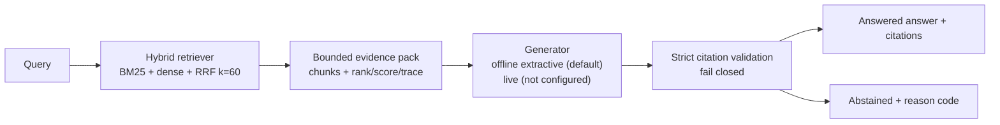

# Evidence-Grounded RAG System

A greenfield RAG system where **answers are bound to evidence**: hybrid
retrieval (sparse + dense), generation with citations, mandatory abstention,
and reproducible retrieval and claim-support evaluation. Answers are only as good as the passages that
support them, and the system abstains with a stable reason code when the
evidence is missing.

**Status — implementation complete for the declared scope.** Synthetic-fixture evaluation is the
default and is fully committed and reproducible. One real-local corpus
(Python 3.12.13 documentation, **3 files / 70 chunks**) is approved for local
development only, and one local semantic embedding model (BAAI/bge-small-en-v1.5)
is approved and opt-in. **Live LLM generation was NOT evaluated** — no
provider/model/credentials are configured. The Gob.ec corpus is **blocked and
unused** (license discrepancy unresolved).


## Capabilities

| Capability | What it does |
| --- | --- |
| License-gated corpus | No real corpus is served until its license contract is satisfied; Gob.ec is blocked and unused (`docs/corpus-license-contract.md`) |
| Stable provenance | Versioned source manifests with pinned revisions and SHA-256 checksums; raw text and weights are never committed, manifests are |
| Sparse retrieval | Okapi BM25 (`k1 = 1.5`, `b = 0.75`, no stemming) — lexical, deterministic |
| Semantic retrieval | Local semantic embeddings (BAAI/bge-small-en-v1.5, opt-in) plus a deterministic non-semantic hash diagnostic; never a silent fallback |
| Hybrid retrieval | BM25 + dense embeddings fused with reciprocal rank fusion (RRF, `k = 60`) |
| Evidence-grounded generation | Every claim cites the exact chunk that supports it; generator only sees a bounded evidence pack |
| Strict citation validation | Fail-closed: a citation must exist, be exposed, match the excerpt, and be referenced by a claim — or the answer is refused |
| Mandatory abstention | Refuses with a stable reason code when evidence is insufficient, unsupported, or conflicting |
| Claim support check | Deterministic `normalized-exact-containment-v1`: a claim is supported iff its normalized text is a substring of the cited chunk (**containment, not semantic entailment**) |
| Offline generation | Deterministic extraction, not an LLM (`is_llm_generated = False`) |
| Live provider boundary | Provider-neutral adapter, deliberately unconfigured; requires an injected transport, fails closed with `provider_unavailable`, never falls back to offline |
| Reproducible evaluation | Committed metric formulas + committed versioned query sets; every number reproducible from one command |
| Testing | Real-behavior pytest suite, fully offline; abstention is tested as required behavior |

Offline generation is **deterministic extraction, not an LLM** (`is_llm_generated = False`).
Live generation is provider-neutral and deliberately unconfigured: it requires an
injected transport, fails closed with `provider_unavailable`, and never falls back
to offline. See `docs/generation-contract.md`.

## Why

Fluent answers are not trustworthy answers. Without mandatory citation and
abstention, a RAG system can sound certain while fabricating. This project
makes evidence the product: retrieval quality is reported separately from
faithfulness, and **retrieval quality does not prove answer faithfulness.**

## Architecture



```text
src/evidence_grounded_rag/
├── corpus/        # license-gated loading, source-manifest audit, privacy, checksums
├── text/          # shared deterministic tokenizer (v1, no stemming)
├── retrieval/     # BM25, dense, RRF fusion, hybrid engine, traces
├── embeddings/    # embedding protocol + deterministic non-semantic embedding + opt-in local semantic provider
├── generation/    # claim/citation models, extractive provider, live adapter, frozen prompt
├── validation/    # strict citation validation (fail-closed)
├── abstention/    # mandatory abstention reason codes
├── evaluation/    # committed metrics, versioned query sets, materializers
└── pipeline.py    # EvidenceRagPipeline: retrieve → generate → validate
```

## The four retrieval modes

| Mode | What serves it | Semantic? |
| --- | --- | --- |
| **BM25 sparse baseline** | Okapi BM25 (`k1 = 1.5`, `b = 0.75`, no stemming) | No — lexical |
| **Hash embedding diagnostic** | `deterministic-hashed-bow-v1`, 256-dim, offline, no weights | **No — explicitly NON-semantic**; scores encode token overlap only |
| **Local semantic embeddings** | BAAI/bge-small-en-v1.5 (384-dim, opt-in, local-only, pinned revision) | Yes |
| **Semantic hybrid** | BM25 + local semantic embeddings, RRF `k = 60` | Yes (semantic component) |

Semantic modes load the verified local model with `local_files_only=True` and
**never fall back** to hash embeddings; if the model is unavailable, semantic
retrieval is disabled with an actionable message. Contract:
`docs/embedding-model-contract.md`.

## Evaluation (all numbers from committed reports)

### Synthetic fixture (default) — `data/manifests/evaluation-synthetic-v1.0.0.json`

Deterministic, 11 committed queries over fictional "Aurora City" fixtures. These
numbers describe **fictional content**, not any real institution.

| recall@1 | recall@5 | recall@10 | MRR | nDCG@5 | answerable coverage | abstention rate | unsupported claims |
| --- | --- | --- | --- | --- | --- | --- | --- |
| 0.8333 | 1.0000 | 1.0000 | 1.0000 | 1.0000 | 1.0000 | 0.3636 | 0.0000 |

### Real-local generation (hybrid / offline extractive) — `python-docs-real-generation-evaluation-v1.0.0.json`

18 queries (12 answerable, 6 non-answerable). **Diagnostic only.** Live
generation is explicitly NOT measured: no provider/model/credentials exist, so
no LLM produced any of these numbers.

| answer coverage | abstention rate | abstention precision | abstention recall | citation precision | citation completeness | claim support |
| --- | --- | --- | --- | --- | --- | --- |
| 0.9167 | 0.3889 | 0.5714 | 0.6667 | 1.0000 | 1.0000 | 1.0000 (19/19) |

Failures: 3 answerable abstentions (`insufficient_evidence`) and 2 wrong answers.

### Real-local semantic retrieval (retrieval-only) — `python-docs-real-semantic-evaluation-v1.0.0.json`

Answerable group (12 queries) per mode. **No generation, no LLM, no faithfulness
metrics here.** Retrieval quality does not imply answer faithfulness.

| Mode | recall@1 | recall@5 | recall@10 | MRR | nDCG@5 |
| --- | --- | --- | --- | --- | --- |
| BM25 sparse baseline | 0.5417 | 0.7917 | 0.8750 | 0.7202 | 0.7207 |
| Hash embedding diagnostic | 0.3333 | 0.5417 | 0.8333 | 0.4545 | 0.4289 |
| Local semantic embeddings | 0.6667 | 0.8750 | 0.9167 | 0.8333 | 0.8035 |
| Semantic hybrid | 0.6250 | 0.9167 | 0.9583 | 0.7778 | 0.7968 |

### Real-local hash diagnostic (claim-support per mode) — `python-docs-real-evaluation-v1.0.0.json`

The earlier diagnostic report (deterministic hash dense mode), kept separate.
**Claim support here is containment, not full faithfulness evaluation.**

| Mode | answerable coverage | abstention precision | abstention recall | unsupported claims | wrong answers |
| --- | --- | --- | --- | --- | --- |
| BM25 sparse | 0.9167 | 0.7500 | 0.5000 | 0.0000 | 3 |
| Dense (hash, non-semantic) | 0.7500 | 0.6250 | 0.8333 | 0.0000 | 1 |
| Hybrid | 0.7500 | 0.5714 | 0.6667 | 0.0000 | 2 |

All reports live in `data/evaluations/`. Protocol: `docs/retrieval-evaluation-protocol.md`.

## Limitations

> - **Live LLM generation was NOT evaluated.** No provider/model/credentials are
>   configured. Offline generation is deterministic extraction, not an LLM.
> - **Claim support is normalized containment, not entailment.** A claim is
>   supported iff its normalized text appears verbatim in the cited chunk.
> - **The real corpus is tiny and diagnostic.** Python 3.12.13 docs, 3 files /
>   70 chunks, approved for local development only — not validation of Python
>   documentation in general and not production readiness.
> - **Raw real documents and model weights are not committed.** They live only
>   under gitignored `data/raw/`; the committed artifacts are manifests and
>   checksums.
> - **Small denominators.** Up to 12 answerable / 6 non-answerable queries per
>   report; one query moves percentages by up to 8.3 points.
> - **Gob.ec is blocked and unused.** Its CC-BY-4.0 label conflicts with the
>   linked `by/3.0/ec` terms; the discrepancy is unresolved
>   (`docs/corpus-license-contract.md`).
> - No production-ready, hallucination-free, or benchmark-parity claim is made.

## Run the system

```bash
uv sync --dev --extra demo           # core + demo (no model stack)
uv run pytest                        # real behavior tests, offline
uv run ruff check .                  # lint
uv run --extra demo streamlit run scripts/demo_retrieval.py   # offline demo
```

Optional semantic embeddings (large torch/transformers footprint):

```bash
uv sync --dev --extra demo --extra embeddings
uv run python scripts/acquire_embedding_model.py --manifest data/manifests/embedding-model-v1.0.0.json
uv run python scripts/verify_embedding_model.py --manifest data/manifests/embedding-model-v1.0.0.json
```

## 60-90 second walkthrough

1. **Open the demo.** A SYNTHETIC / OFFLINE banner and the corpus & license
   panel are visible, including the real-corpus blocker (Gob.ec blocked).
2. **Ask a supported question.** The default query
   *"What must a permit application include?"* answers with a cited claim —
   *"A permit application must include a signed code of conduct and a contact
   phone number. [1]"* — and citation validation shows **VALID**.
3. **Trigger a conflict.** Ask *"How much is the special event fee per day?"*:
   two contradictory schedules exist, so the system shows
   **CONFLICTING EVIDENCE: conflicting_evidence** and explains the contradiction.
4. **Trigger abstention.** Ask *"What is the fine for littering in Millbrook?"*:
   out of corpus, so the system abstains with `unsupported_query`.
5. **Compare modes.** Switch sparse / dense / hybrid (or, on the real-local
   corpus, the four labeled modes). The answer is grounded on the selected mode
   while all candidates stay visible.
6. **Trace any claim.** The evidence pack, trace, and versions/config panels
   trace each claim to a specific chunk, rank, score, and committed version.

Full script: `docs/demo-script.md`.

Additional screenshots (real app output, captured in offline mode):
[synthetic overview](docs/assets/publication/01-synthetic-overview.png) ·
[abstention](docs/assets/publication/03-abstention.png) ·
[real-local semantic retrieval](docs/assets/publication/04-real-local-semantic.png) ·
[model unavailable](docs/assets/publication/05-model-unavailable.png).

## Reproduce the evaluations

```bash
uv run python -m evidence_grounded_rag.evaluation.materialize   # synthetic report
uv run python -m evidence_grounded_rag.evaluation.real_materialize \
    --manifest data/manifests/corpus-source-v1.0.0.json \
    --queries data/evaluation/queries/python-docs-real-v1.0.0.json \
    --raw-dir data/raw/python-docs-3.12.13 \
    --output data/evaluations/python-docs-real-evaluation-v1.0.0.json
uv run python -m evidence_grounded_rag.evaluation.generation_materialize \
    --manifest data/manifests/corpus-source-v1.0.0.json \
    --queries data/evaluation/queries/python-docs-real-v1.0.0.json \
    --raw-dir data/raw/python-docs-3.12.13 \
    --fixture data/fixtures/answer-evaluation-v1.0.0.json \
    --output data/evaluations/python-docs-real-generation-evaluation-v1.0.0.json
uv run python -m evidence_grounded_rag.evaluation.semantic_materialize \
    --manifest data/manifests/corpus-source-v1.0.0.json \
    --queries data/evaluation/queries/python-docs-real-v1.0.0.json \
    --raw-dir data/raw/python-docs-3.12.13 \
    --model-manifest data/manifests/embedding-model-v1.0.0.json \
    --cache-dir data/raw/models/bge-small-en-v1.5 \
    --output data/evaluations/python-docs-real-semantic-evaluation-v1.0.0.json
```

Real-local corpus verification (offline):

```bash
uv run python scripts/acquire_corpus.py --manifest data/manifests/corpus-source-v1.0.0.json
uv run python scripts/verify_corpus.py --manifest data/manifests/corpus-source-v1.0.0.json
```

## Repository structure

```text
src/evidence_grounded_rag/   # package (src layout)
tests/                       # pytest, real behavior only
docs/                        # contracts, protocols, demo script, publication assets
data/fixtures/               # committed synthetic fixtures
data/manifests/              # committed versioned manifests + checksums
data/evaluations/            # committed evaluation reports (JSON)
data/evaluation/queries/     # committed real-local query set
data/raw/ data/processed/    # gitignored runtime output (corpus, model weights)
scripts/                     # acquisition, verification, materialization, demo
deploy/                      # deployment notes (later)
```

## Data and license limits

- The repo is MIT; it covers only original code and the synthetic fixtures.
  Third-party documents retain their own terms.
- The approved real-local corpus (Python 3.12.13 docs, PSF License v2) is used
  for local development only; its raw text is never committed, packaged, or
  published (`docs/corpus-license-contract.md`).
- Model weights and raw corpora are never committed (`data/raw/` is
  gitignored); manifests and checksums are.
- No unlicensed corpus is indexed, ever. Gob.ec is not used.
- Evidence requirements: corpus license contract satisfied before any real
  corpus; protocol committed before results; every number reproducible from one
  command and a committed query set; abstention tested as required behavior.
