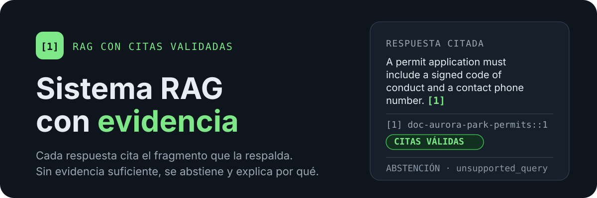
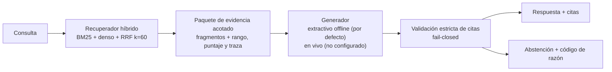

<p align="center"></p>

<p align="center"><b>Español</b> · <a href="README.en.md">English</a></p>

Sistema RAG en el que cada respuesta está ligada a la evidencia: recuperación híbrida (BM25 + embeddings), citas validadas de forma estricta, abstención obligatoria y evaluación reproducible. Se ejecuta offline por defecto, sin claves de API.

[](https://github.com/Eduardo12Pacheco/sistema-rag-con-evidencia/actions/workflows/ci.yml) [](LICENSE) [](pyproject.toml)

> **Estado: implementación completa para el alcance declarado.** La generación en vivo con LLM **no está evaluada**: no hay proveedor, modelo ni credenciales configurados. La generación por defecto es extractiva y determinista; no es un LLM (`is_llm_generated = False`).

## Por qué existe

Una respuesta fluida no es una respuesta confiable. Sin citas obligatorias ni abstención, un sistema RAG puede sonar seguro mientras inventa. Este proyecto hace de la evidencia el producto:

- **Las citas se validan; no se dan por buenas.** Una cita debe existir, haber sido expuesta al generador, coincidir exactamente con el texto del fragmento y ser referida por una afirmación. Si falla una sola condición, la respuesta se rechaza (fail-closed).
- **La abstención es un resultado válido.** Cuando la evidencia falta, es insuficiente o es conflictiva, el sistema devuelve un código de razón estable en lugar de una respuesta débil. Un proveedor en vivo no configurado responde `provider_unavailable` y nunca cae al modo offline.
- **Recuperación y fidelidad se miden por separado.** Un recall alto no prueba que la respuesta sea fiel, y los reportes lo declaran así.
- **El núcleo no tiene dependencias de runtime.** La demo (`streamlit`) y los embeddings semánticos (`sentence-transformers`) son extras opcionales.

## Demo (offline)


Salida real de la demo sobre el corpus sintético:

| Consulta | Estado | Resultado |
| --- | --- | --- |
| `What must a permit application include?` | `answered` | Respuesta citada: *"A permit application must include a signed code of conduct and a contact phone number. [1]"*. Citas **VÁLIDAS**. |
| `How much is the special event fee per day?` | `conflicting` | `conflicting_evidence`: hay dos tarifas contradictorias y el sistema muestra el conflicto. |
| `What is the fine for littering in Millbrook?` | `abstained` | `unsupported_query`: la pregunta está fuera del corpus. |

Guion completo y capturas adicionales en [`docs/demo-script.md`](docs/demo-script.md) y [`docs/assets/publication/`](docs/assets/publication/).

## Arquitectura

Una consulta pasa por el recuperador híbrido, se empaqueta como evidencia acotada, el generador produce afirmaciones citadas y el validador decide si la respuesta se publica o el sistema se abstiene.



```text
src/evidence_grounded_rag/
├── corpus/        # carga con gate de licencia, auditoría de source manifest, privacidad, checksums
├── text/          # tokenizador determinista compartido (v1, sin stemming)
├── retrieval/     # BM25, dense, fusión RRF, motor híbrido, traces
├── embeddings/    # protocolo, embedding hash no semántico y proveedor semántico local opt-in
├── generation/    # modelos de afirmación/cita, proveedor extractivo, adaptador en vivo, prompt congelado
├── validation/    # validación estricta de citas (fail-closed)
├── abstention/    # códigos de razón de abstención obligatoria
├── evaluation/    # métricas comprometidas, conjuntos de consultas versionados, materializers
└── pipeline.py    # EvidenceRagPipeline: retrieve → generate → validate
```

## Modos de recuperación

| Modo | Qué lo sirve | ¿Semántico? |
| --- | --- | --- |
| **Sparse BM25** | Okapi BM25 (`k1 = 1.5`, `b = 0.75`, sin stemming) | No: léxico |
| **Diagnóstico con embedding hash** | `deterministic-hashed-bow-v1`, 256 dimensiones, offline, sin pesos | **No**: solo mide solapamiento de tokens |
| **Embeddings semánticos locales** | BAAI/bge-small-en-v1.5 (384 dimensiones, opt-in, solo local, revisión fijada) | Sí |
| **Híbrido semántico** | BM25 + embeddings semánticos locales, fusión RRF `k = 60` | Sí (componente semántico) |

Los modos semánticos cargan el modelo local verificado con `local_files_only=True` y **nunca** caen a embeddings hash. Si el modelo no está disponible, la recuperación semántica se deshabilita con un mensaje accionable. Contrato: [`docs/embedding-model-contract.md`](docs/embedding-model-contract.md).

## Resultados

Todos los números salen de reportes comprometidos en `data/evaluations/` y `data/manifests/`. Cada uno se reproduce con un comando; ver [Reproducir las evaluaciones](#reproducir-las-evaluaciones).

### Fixture sintético (por defecto)

11 consultas sobre fixtures ficticios de "Aurora City". Describen contenido ficticio, no una institución real.

| recall@1 | recall@5 | recall@10 | MRR | nDCG@5 | Cobertura de respuestas | Tasa de abstención | Afirmaciones no soportadas |
| --- | --- | --- | --- | --- | --- | --- | --- |
| 0.8333 | 1.0000 | 1.0000 | 1.0000 | 1.0000 | 1.0000 | 0.3636 | 0.0000 |

### Corpus local real: documentación de Python 3.12.13

3 archivos y 70 fragmentos, aprobados solo para desarrollo local. Hay 18 consultas: 12 respondibles y 6 no respondibles.

**Recuperación** (12 consultas respondibles; no hay generación en esta tabla):

| Modo | recall@1 | recall@5 | recall@10 | MRR | nDCG@5 |
| --- | --- | --- | --- | --- | --- |
| Sparse BM25 | 0.5417 | 0.7917 | 0.8750 | 0.7202 | 0.7207 |
| Diagnóstico con embedding hash | 0.3333 | 0.5417 | 0.8333 | 0.4545 | 0.4289 |
| Embeddings semánticos locales | 0.6667 | 0.8750 | 0.9167 | 0.8333 | 0.8035 |
| Híbrido semántico | 0.6250 | 0.9167 | 0.9583 | 0.7778 | 0.7968 |

**Generación offline** (extractiva, solo diagnóstico):

| Cobertura de respuestas | Tasa de abstención | Precisión de abstención | Recall de abstención | Precisión de citas | Completitud de citas | Soporte de afirmaciones |
| --- | --- | --- | --- | --- | --- | --- |
| 0.9167 | 0.3889 | 0.5714 | 0.6667 | 1.0000 | 1.0000 | 1.0000 (19/19) |

Fallos: 3 abstenciones en consultas respondibles (`insufficient_evidence`) y 2 respuestas incorrectas.

**Fidelidad por modo** (diagnóstico; el modo "dense" usa embedding hash, no semántico):

| Modo | Cobertura de respuestas | Precisión de abstención | Recall de abstención | Afirmaciones no soportadas | Respuestas incorrectas |
| --- | --- | --- | --- | --- | --- |
| Sparse BM25 | 0.9167 | 0.7500 | 0.5000 | 0.0000 | 3 |
| Dense (hash, no semántico) | 0.7500 | 0.6250 | 0.8333 | 0.0000 | 1 |
| Híbrido (dense = hash) | 0.7500 | 0.5714 | 0.6667 | 0.0000 | 2 |

Con denominadores tan pequeños, una sola consulta mueve los porcentajes hasta 8,3 puntos. El soporte de afirmaciones es contención normalizada, no entailment semántico.

## Inicio rápido

Requisitos: [uv](https://docs.astral.sh/uv/) y Python 3.11 o superior (uv puede instalar el intérprete si no lo tiene).

```bash
uv sync --dev --extra demo                                  # dependencias, pruebas y demo
uv run pytest                                               # suite offline
uv run ruff check .                                         # lint
uv run --extra demo streamlit run scripts/demo_retrieval.py # demo en el navegador
```

`uv run pytest` omite las pruebas que necesitan el corpus real local o el extra `embeddings` cuando esos artefactos no existen.

<details>
<summary>Corpus real local (opcional, no se compromete)</summary>

```bash
uv run python scripts/acquire_corpus.py --manifest data/manifests/corpus-source-v1.0.0.json
uv run python scripts/verify_corpus.py --manifest data/manifests/corpus-source-v1.0.0.json
```

La adquisición descarga los archivos desde URLs fijadas y verifica sus SHA-256. Los archivos quedan en `data/raw/`, que está excluido del control de versiones.

</details>

<details>
<summary>Embeddings semánticos locales (opcional, instala torch y transformers)</summary>

```bash
uv sync --dev --extra demo --extra embeddings
uv run python scripts/acquire_embedding_model.py --manifest data/manifests/embedding-model-v1.0.0.json
uv run python scripts/verify_embedding_model.py --manifest data/manifests/embedding-model-v1.0.0.json
```

</details>

## Reproducir las evaluaciones

Ejecute estos comandos desde la raíz del repositorio. Los comandos con corpus real requieren el corpus local (ver [Inicio rápido](#inicio-rápido)).

```bash
uv run python -m evidence_grounded_rag.evaluation.materialize            # fixture sintético

uv run python -m evidence_grounded_rag.evaluation.real_materialize \
    --manifest data/manifests/corpus-source-v1.0.0.json \
    --queries data/queries/python-docs-real-v1.0.0.json \
    --raw-dir data/raw/python-docs-3.12.13 \
    --output data/evaluations/python-docs-real-evaluation-v1.0.0.json

uv run python -m evidence_grounded_rag.evaluation.generation_materialize \
    --manifest data/manifests/corpus-source-v1.0.0.json \
    --queries data/queries/python-docs-real-v1.0.0.json \
    --raw-dir data/raw/python-docs-3.12.13 \
    --fixture data/fixtures/answer-evaluation-v1.0.0.json \
    --output data/evaluations/python-docs-real-generation-evaluation-v1.0.0.json

uv run python -m evidence_grounded_rag.evaluation.semantic_materialize \
    --manifest data/manifests/corpus-source-v1.0.0.json \
    --queries data/queries/python-docs-real-v1.0.0.json \
    --raw-dir data/raw/python-docs-3.12.13 \
    --model-manifest data/manifests/embedding-model-v1.0.0.json \
    --cache-dir data/raw/models/bge-small-en-v1.5 \
    --output data/evaluations/python-docs-real-semantic-evaluation-v1.0.0.json
```

## Limitaciones

- **La generación en vivo con LLM no fue evaluada.** No hay proveedor, modelo ni credenciales configurados. La generación offline es extracción determinista, no un LLM.
- **El soporte de afirmaciones es contención normalizada, no entailment.** Una afirmación está respaldada si su texto normalizado aparece literalmente en el fragmento citado.
- **El corpus real es pequeño y de diagnóstico.** Son 3 archivos y 70 fragmentos de la documentación de Python 3.12.13, aprobados solo para desarrollo local. No es una validación de la documentación de Python en general ni de aptitud para producción.
- **Los denominadores son pequeños.** Hasta 12 consultas respondibles y 6 no respondibles por reporte.
- **Gob.ec está bloqueado y sin usar.** Su etiqueta CC-BY-4.0 entra en conflicto con los términos `by/3.0/ec` enlazados, y la discrepancia no está resuelta ([contrato](docs/corpus-license-contract.md)).
- No se hace ninguna afirmación de aptitud para producción, ausencia de alucinaciones ni paridad de benchmark.

## Documentación

- [Producto](docs/PRODUCT.md) · [Diseño](docs/DESIGN.md) · [Guion de la demo](docs/demo-script.md)
- [Contrato de generación](docs/generation-contract.md) · [Contrato del modelo de embeddings](docs/embedding-model-contract.md) · [Contrato de corpus y licencia](docs/corpus-license-contract.md)
- [Protocolo de retrieval y evaluación](docs/retrieval-evaluation-protocol.md)

## Datos y licencia

- El código original y los fixtures sintéticos se distribuyen bajo la licencia MIT ([`LICENSE`](LICENSE)). El texto MIT no cubre datos de terceros, manifests, citas de fuentes ni otro contenido externo, que conservan sus propios términos.
- El corpus real aprobado (documentación de Python 3.12.13, PSF License v2) se usa solo para desarrollo local. Su texto crudo nunca se compromete, empaqueta ni publica.
- Los pesos de BAAI/bge-small-en-v1.5 (MIT) se descargan localmente con revisión fijada y no se comprometen. Los manifests y checksums sí.
- Ningún corpus sin licencia se indexa. Gob.ec no se usa.

## Autor

Eduardo Pacheco · [github.com/Eduardo12Pacheco](https://github.com/Eduardo12Pacheco)
